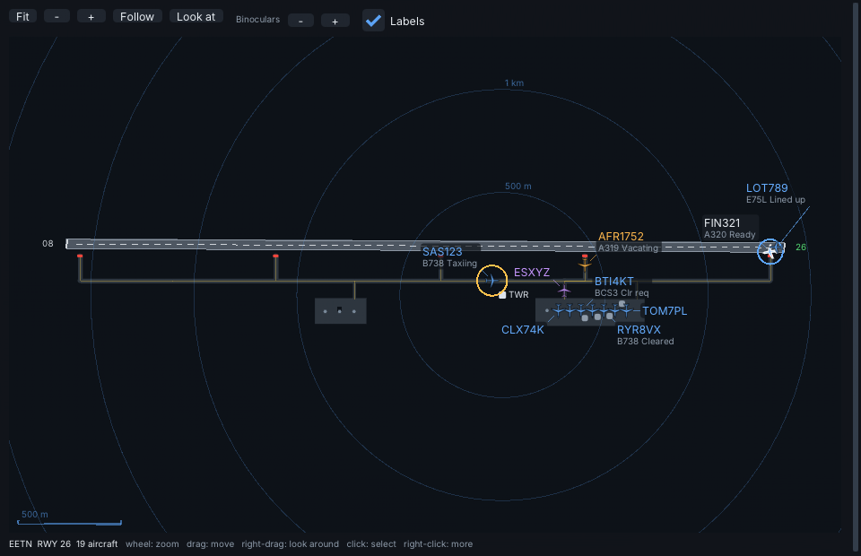
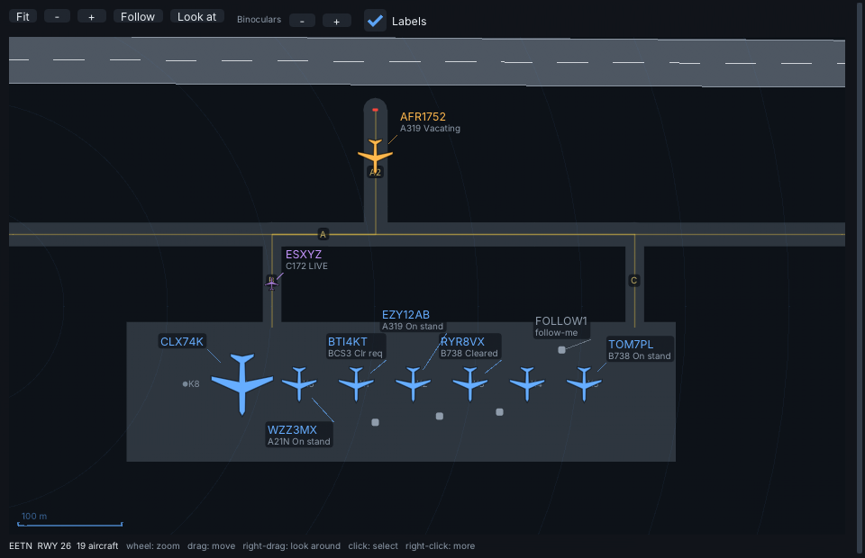
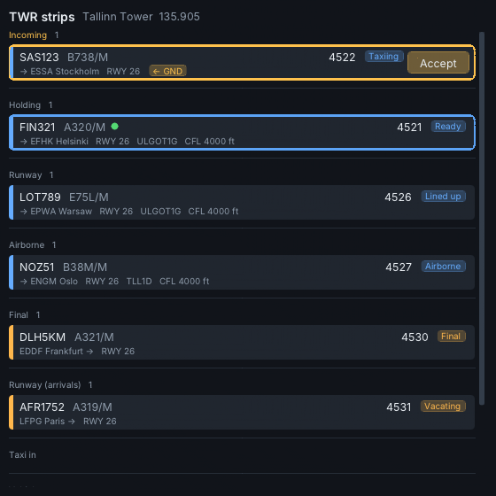
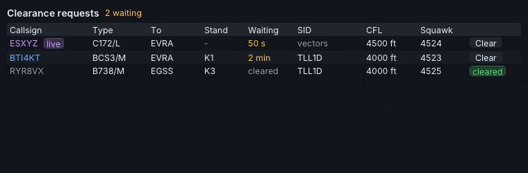
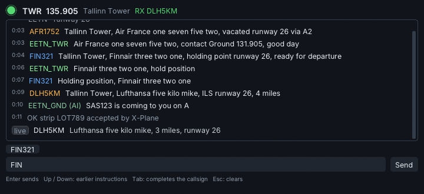
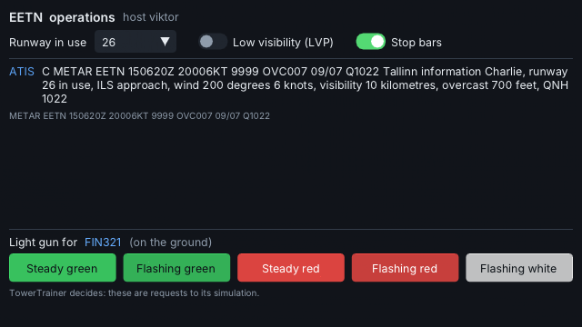
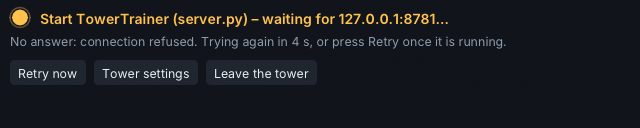
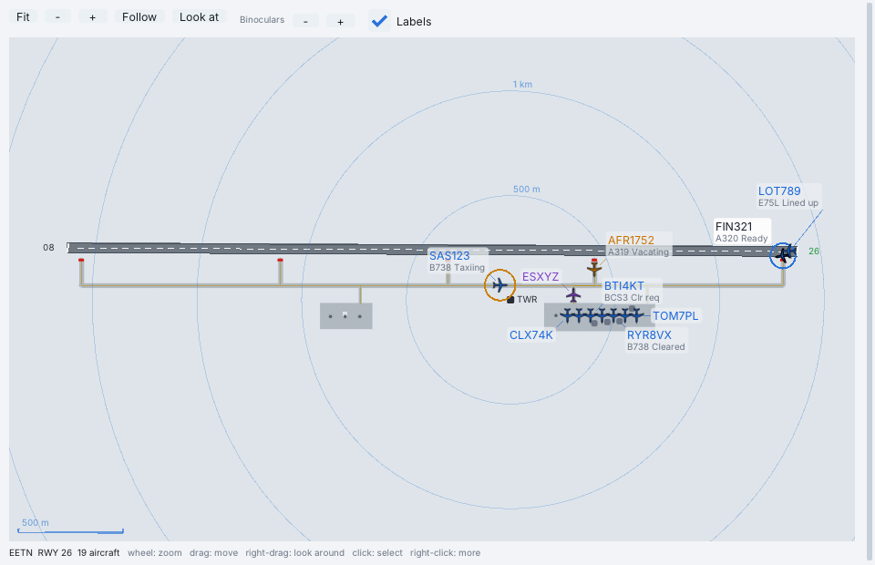

# Control from the tower in X-Plane (Tower mode)

Tower mode puts you in the tower cab of the airport TowerTrainer is running, inside X-Plane, with the
trainer's traffic in the sky and on the taxiways. TowerTrainer stays the authority: every instruction you
give goes to its simulation, and what you see in the windows is what its radar shows. It works with
XRadio connected to a flight (the AI traffic then comes through XRadio's injector, see `docs/atc.md`) and
just as well standalone against TowerTrainer's `server.py` alone.

## Set up

1. Start TowerTrainer (`start.bat` / `python server.py`). It opens a *tower link* on `127.0.0.1:8781`
   (`--tower-port 0` switches it off; `--host 0.0.0.0` lets another PC's X-Plane connect).
2. In the trainer: Settings → XRadio → tick **X-Plane tower link (session code TOWER)**. The trainer's
   window now hosts a multiplayer session with the code `TOWER` (you can also host one by hand under
   Multiplayer; then type its code in the plugin).
3. In X-Plane: XRadio → Settings → **Tower** tab: TowerTrainer's address and port, the session code, the
   position you work (TWR, GND, DEL, APP, CTR), your nickname, whether your own aircraft is frozen while
   you are in the tower, whether the trainer's visibility / wind / time should be set in X-Plane, the cab
   height (0 = from the scenery), and whether the trainer's traffic is drawn as CSL models when XRadio is
   not connected to a flight.
4. Plugins → XRadio → **Tower mode** (or bind the command `xradio/tower/toggle`).

## In the tower

* The camera goes to the cab: the tower viewpoint from the airport's `apt.dat` (row 14, custom scenery
  first), else the tower OpenStreetMap knows, else the apron centre, 30 m up. Drag in the radar window or
  use the commands `xradio/tower/look_left|right|up|down` to look around, the mouse wheel or
  `xradio/tower/zoom_in|out` for binoculars, **Follow** (or `xradio/tower/next_target`) to track an
  aircraft, `xradio/tower/ground_view` for a look from the apron, `xradio/tower/tower_view` to get back
  after X-Plane took the view (any view change does). In VR the cab is where your head is.
* Your own aircraft is frozen where it stood (`override_planepath`) and put back exactly — position,
  attitude, velocities — when you leave.
* The windows are XRadio's own (Dear ImGui, the main window's theme and fonts, see `docs/ui.md`): each
  one resizes, pops out into its own OS window with the button at its top right (and back), sits in VR
  like the main window, follows the UI scale on HiDPI screens and is where you left it next time (Plugins →
  XRadio → Reset window position puts them all back on the screen). `xradio/tower/windows` hides and shows them. They
  come up once the trainer has sent the airport:
  * **Ground radar** — the airport as TowerTrainer knows it: pavement, taxiways with their centre lines and
    names, runways with markings and designators (the one in use green, a closed one crossed out), stands,
    stop bars (red while lit), range rings round the tower. Aircraft are silhouettes at their real size for
    their wake category, coloured by what they are — departures blue, arrivals amber, live pilots violet,
    vehicles grey, an emergency red — with labels that never cover one another (callsign; type and state
    on the ground, level and speed in the air). A busy apron is decluttered the way TowerTrainer's own
    radar does it: a parked aircraft shows its callsign alone when zoomed out (nothing further out) and
    gives up its label when there is no room, a service vehicle shows its label while the mouse is on it.
    The wheel zooms about the mouse, dragging moves the picture, **Fit** shows the whole airport. A click
    selects an aircraft (and starts an instruction with its callsign); right-click: select, follow with
    the camera, look at it, accept its handoff; right-drag turns the camera; **Binoculars −/+**; **Follow**
    and **Look at** for the selected aircraft.
  * **Strips** — your position's strip bays exactly as the trainer sorts them (Incoming, Pending, Cleared,
    Push, Taxi, Holding, Runway, …; the whole board when positions are not split). Cards are coloured
    departure / arrival and carry the type, squawk, runway, SID and level, how long a request has waited
    and the trainer's warnings. Click selects, **Accept** takes an incoming handoff, and dragging a card
    onto another bay moves it there (the trainer keeps it there until the aircraft's state changes).
  * **Delivery** — the clearance requests with what the trainer suggests: SID, initial climb, squawk, how
    long each has waited. **Clear** puts the trainer's whole clearance in the command line — change what
    you like, Enter sends it.
  * **Frequency** — your position's log as a chat, coloured by who speaks (you, the AI controllers,
    departures, arrivals, live pilots, vehicles, problems in amber), live calls as they come, and a TX light
    while you key XRadio's push-to-talk. The command line: Enter sends, Up / Down go through what you sent,
    Tab completes a callsign (the candidates are offered as chips), Esc clears; selecting an aircraft in
    any window puts its callsign in front of what you are typing.
  * **ATIS / operations** — the ATIS and METAR, the runway in use, LVP and stop-bar switches, and the light
    gun in its real colours (steady and flashing green, steady and flashing red, flashing white) with what
    each signal means on the ground and in the air; it waits until an aircraft is selected.
  * **The connection banner** — one place that says what is missing, instead of error text in every
    window: *Start TowerTrainer (server.py) – waiting for 127.0.0.1:8781…* with **Retry now** (the plugin
    also tries again by itself, after 1, 2, 4 and 8 s, then every 10 s), a hint to tick the X-Plane tower link in
    TowerTrainer when no session is hosted, a note when the trainer's window was closed. **Tower settings**
    opens Settings → Tower, **Leave the tower** ends Tower mode.

  The text-only fallback build (`-DXRADIO_UI_IMGUI=OFF`) has no tower windows: the camera, the frozen
  aircraft and the traffic work the same, and TowerTrainer's own window is the scope.
* What you type is exactly what you would type in TowerTrainer: `FIN321 runway 26 cleared for takeoff`,
  `SAS123 taxi to holding point 26 via A B`, `DLH5KM light green steady`. The pilots answer in the
  trainer (and over XRadio's voice when the AI voices are on there).
* Speaking: key XRadio's push-to-talk as usual. The voice goes to the pilots on XRadio; the instruction
  itself still has to reach the trainer — type it, or keep the trainer's own window open with its
  speech recognition (Ctrl+Space), which hears the same microphone.

## How it talks to TowerTrainer

`towerlink.py` in TowerTrainer accepts a TCP connection and one JSON object per line. The first line is
`{"type":"hello","code":"TOWER","name":"X-Plane","pos":"TWR","version":"0.6.0"}`; after that the plugin is
an ordinary remote controller of the trainer's multiplayer session: it receives the same `state`
snapshots the trainer's pop-out windows get — with the Delivery list (each request with the trainer's
suggested SID, climb, squawk and its own clearance text) and the stop-bar state — plus an `airport` line
with the datum, runways, holding points, stands, the taxi network (`taxi`: nodes and named edges with
their widths) and the hard pavement (`pavement`: polygons with holes, simplified to 1 m) so the radar
can draw the airport and metres become latitude and longitude. It sends `claim`, `tx`, `strip` (a strip
moved to another bay), `ops` (`lvp`, `runway`, `stopbars`) and `ping`. Nothing else travels; no audio, no
files. An older TowerTrainer without the taxi network, pavement or Delivery list still works: the radar
then draws runways and stands, and the Delivery window puts the requests together itself.

## Tests

`tools/harness/tower_test.cpp` (built with `-DXRADIO_BUILD_TESTS=ON`) checks the JSON reader, the
`apt.dat` viewpoint parser on `tools/fixtures/apt_tower.dat` (custom scenery first), the METAR parser,
and — with `tools/fake_towertrainer.py` running and `XR_TOWER_PORT` set — the whole round trip: entering
takes the camera to the trainer's tower, freezes the user's aircraft, accepting a handoff, moving a strip,
a typed instruction, LVP, the runway, the stop bars and the light gun reach the trainer as it expects them,
an unreachable trainer is retried (and Retry tries at once), leaving restores the aircraft exactly.
`tools/harness/tower_ui_test.cpp` clicks through the windows themselves without X-Plane or OpenGL — Clear
in Delivery, Enter / history / Tab completion in the frequency window, a strip dragged onto another bay,
an aircraft clicked, zoomed and panned on the radar, the right-click menu, the label filter, the light gun
only with an aircraft selected, Retry on the banner — and draws every window in both themes, tiny and
with nothing linked. `tools/ui_preview` renders them to `docs/ui/tower-*.png` from
`tools/fixtures/tower_preview.jsonl`, which `tools/fake_towertrainer.py --dump` writes (a made-up airport,
not real scenery). TowerTrainer's side has `tests/towerlink_test.py`.

| Ground radar | Close up |
|---|---|
|  |  |

| Strips | Delivery |
|---|---|
|  |  |

| Frequency | ATIS / operations |
|---|---|
|  |  |

The connection banner: 

The light theme: 
