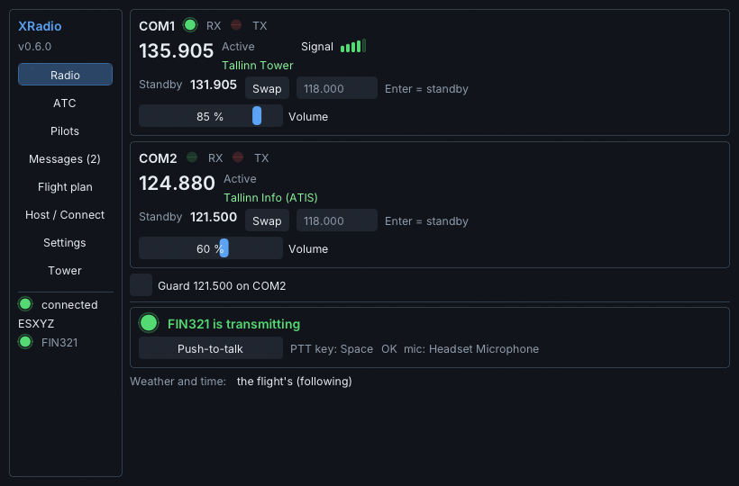
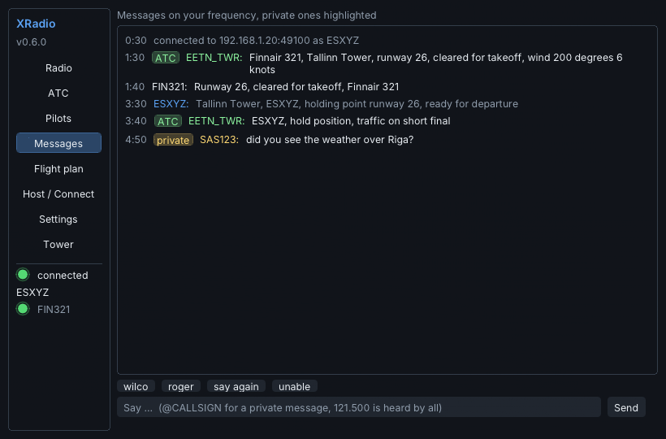
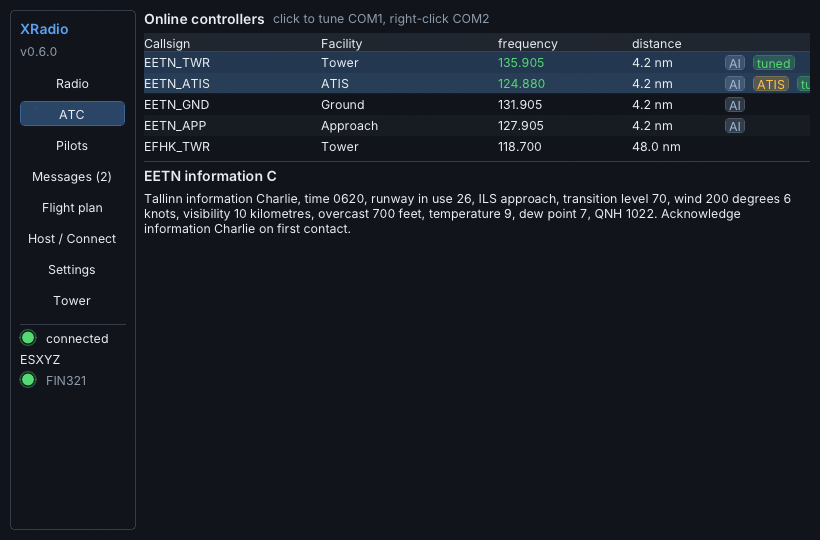
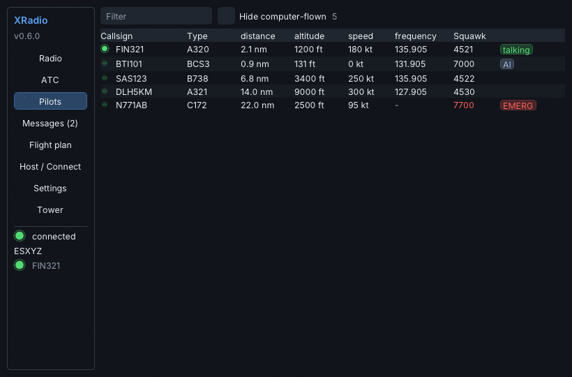
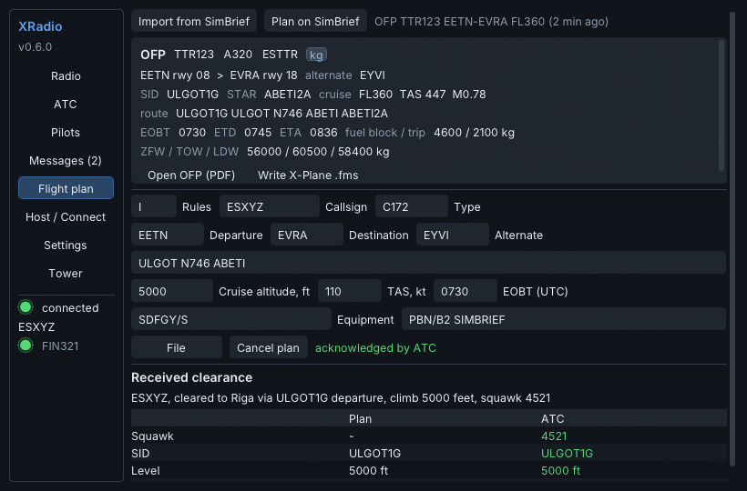
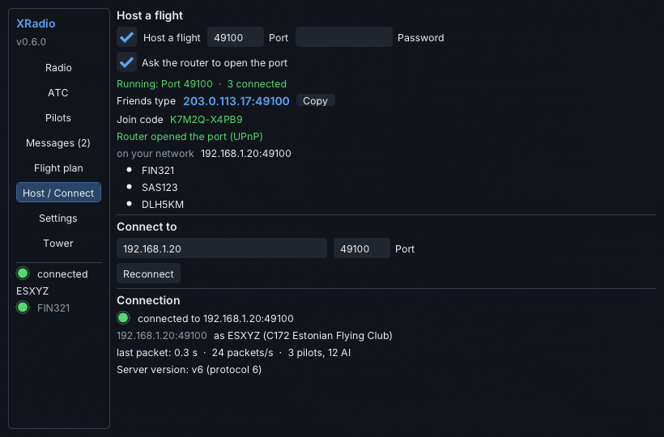
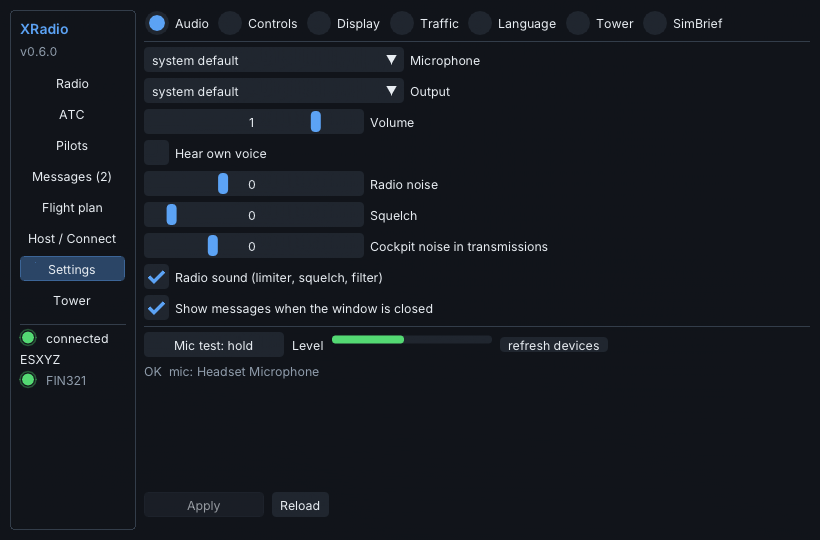
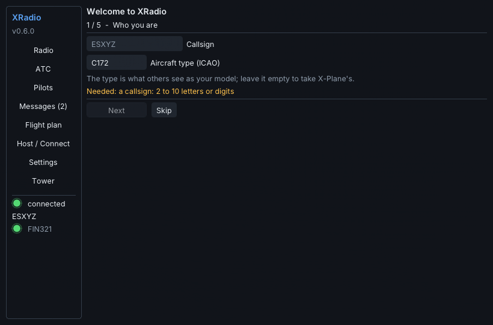
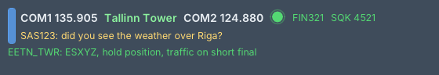
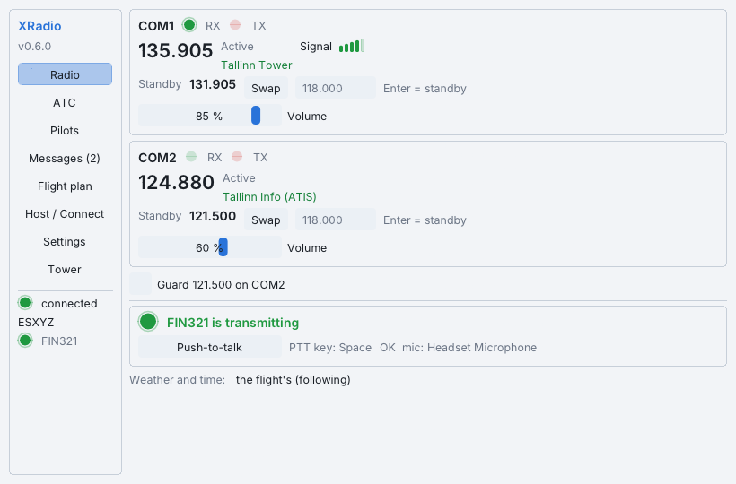

# The XRadio window (v0.6.0)

One window with a sidebar, drawn with [Dear ImGui](https://github.com/ocornut/imgui) (MIT) inside X-Plane's
own windows: it pops out to its own OS window and goes into VR like any X-Plane window, follows the sim's
UI scale (and its own scale setting), and remembers its size, position and tab. The font is Inter (SIL Open
Font License, `plugin/src/ui2/LICENSE-Inter.txt`) with full Latin-Extended coverage (õ ä ö ü š ž). Icons
are drawn, not loaded: round lights, signal bars, level meters, badges. Colours carry meaning only: green is
OK / receiving, red is transmitting / an error, amber is a warning.

The text-only window of earlier versions stays in the tree as a fallback build (`-DXRADIO_UI_IMGUI=OFF`),
and it is what the test harness drives (the stub SDK has no OpenGL).

| Radio | Messages |
|---|---|
|  |  |

| ATC | Pilots |
|---|---|
|  |  |

| Flight plan | Host / Connect |
|---|---|
|  |  |

| Settings | First run |
|---|---|
|  |  |

The cockpit overlay (always on top, click-through except on its handle, auto-hides to one line when the
frequency is quiet, also in VR) and a toast:

The light theme: 

## Tabs

* **Radio** — COM1 and COM2 as a stack: active and standby frequency, the station on the active frequency
  ("Tallinn Tower"), RX / TX lights, the signal strength of the station being heard, swap, scroll-to-tune on
  the standby (shift for 1 MHz), a typed frequency (Enter puts it on standby), a volume per COM, the
  121.500 guard toggle on COM2, the push-to-talk panel with who is transmitting, your microphone level
  while keyed and a stuck-microphone warning after 30 s.
* **ATC** — the controllers online: callsign, facility, frequency, distance, an *AI* badge for
  TowerTrainer's computer controllers, *ATIS* and *tuned* badges. Click tunes COM1 (an ATIS: COM2),
  right-click COM2. The ATIS text of a tuned ATIS is shown below.
* **Pilots** — everybody in the flight with type, distance, altitude, speed, frequency, squawk, a talking
  light, AI / emergency badges; filter and hide-AI; click a pilot to message them.
* **Messages** — the log, chat-style: ATC calls badged green, private messages amber, guard red, your own
  muted; unread count on the tab; quick replies (wilco, roger, say again, unable); `@CALLSIGN` completion.
* **Flight plan** — *Import from SimBrief* (the latest OFP through SimBrief's documented fetch API, username
  or Pilot ID from Settings > SimBrief, only when pressed), the OFP panel (runways, SID/STAR, route, cruise,
  TAS/Mach, EOBT/ETD/ETA, fuel, weights, *Open OFP (PDF)*, *Write X-Plane .fms* into `Output/FMS plans`
  with a second press to overwrite), the editable fields, the checks before filing, *File* (sends
  `PT_FLIGHTPLAN`), cancel, and the plan next to what ATC answered: the clearance text, squawk, SID,
  level and destination, with a difference marked. *Plan on SimBrief* opens SimBrief's new-flight page.
* **Host / Connect** — host a flight (port, password, router/UPnP, the address or join code to share with
  a Copy button, who is connected), join by address or join code, reconnect, and the connection: status,
  last packet, packets per second, pilots and AI counts, the server's protocol version with a clear line
  when it is another XRadio version, and the update notice.
* **Settings** — grouped: Audio (devices, mic test with a level meter, cockpit noise, squelch, radio
  effect), Controls (the PTT key and the Tower-mode key, captured by pressing a key), Display (scale,
  theme, overlay, corner notices), Traffic (CSL folder, labels, AI), Language (English / Eesti), Tower,
  SimBrief (username or Pilot ID).
* **Tower** — enter or leave TowerTrainer's tower cab (`docs/tower-mode.md`).

## First run

The wizard opens when there is no callsign yet: who you are (callsign, aircraft type), audio (devices and
a mic test), push-to-talk (press a key), and the flight (join by address / join code, or host). Skip is
always available; Settings has everything afterwards.

## Code

`plugin/src/ui2/`: `model.h/.cpp` is the view-model (plain data the plugin fills every frame, the actions
the window can ask for, and the logic -- formatting, validation, unread counts, toasts, the wizard's
blockers -- tested by `tools/harness/ui_logic_test.cpp` without ImGui or X-Plane); `app_ui.cpp` draws the
tabs, overlay, toasts and wizard with ImGui only; `imgui_xp.cpp` is the X-Plane host (a context per
window, the shared font atlas uploaded through `XPLMGenerateTextureNumbers` / `XPLMBindTexture2d`,
fixed-pipeline OpenGL rendering, input from the window callbacks, pop-out and VR positioning modes) --
the approach ImgWindow (xsquawkbox / LiveTraffic, BSD) made standard, written fresh here under XRadio's
MIT licence; `host.cpp` owns the two windows and the model; `theme.cpp` the palettes; `i18n.cpp` the
Estonian texts. The network never touches the window: `main.cpp` builds the model from its own state once
per frame. `tools/ui_preview` renders the same drawing functions with a small software rasteriser to the
PNG files in this folder, so the layout can be seen (and reviewed) without the simulator.
